# LAPS AI Image Generation — Model Benchmark

**Organisation:** LAPS AB · Swedish B2B marketing agency  
**Datum:** 2026-11-19  
**Hardware:** HP Z4 Workstation · Ubuntu 26.04 LTS · NVIDIA RTX 4060 Ti (16 GB VRAM) · 64 GB DDR5  
**Runtime:** ComfyUI (`comfy-kitchen` 0.2.41, `flux3` CLIPLoader support)

> Five local diffusion models were benchmarked across five visually diverse prompts.  
> Each image is labelled with the model that generated it and its visual quality score (0–10).

---

## 🏆 Summary Scoreboard

| Model | Neoclassical | Aurora | Ethereal | Bauhaus | Vaporwave | **Total / 50** | Best at |
|---|:---:|:---:|:---:|:---:|:---:|:---:|---|
| **Krea 2 Turbo INT8** | 9.5 | **10** | 8.5 | **10** | 8.5 | **46.5** | Posters & graphic design |
| Z-Image Turbo INT8 | 8 | 9 | 9 | 9.5 | **9.5** | **45.0** | 3D-render, vaporwave |
| Qwen Image 2.1 INT8 | 9 | 9 | 8 | 9.5 | 9 | **44.5** | Conceptual illustration |
| FLUX 3 Klein INT8 | 8.5 | 7 | **9.5** | 8.5 | 9 | **42.5** | Photorealism, portraits |
| Krea 2 Raw FP8 *(deleted)* | 7 | 5 | 9.5 | 6 | 7 | 34.5 | — |

**Bold** = highest score for that prompt.

---

## Test Prompts

Five prompts were chosen to stress-test different model capabilities:

| # | Style | Resolution | Key challenge |
|---|---|---|---|
| 1 | Neoclassical painting | 1920 × 1080 | Art-historical style accuracy, chiaroscuro, composition |
| 2 | Aurora Borealis poster | 1024 × 1536 | Graphic design, editorial illustration, vertical composition |
| 3 | Ethereal loneliness | 1024 × 1280 | Photorealism, human face, editorial photography |
| 4 | Bauhaus 1923 poster | 1024 × 1536 | Geometric design, primary colors, asymmetric grid |
| 5 | Vaporwave web design | 1920 × 1080 | Retro-futurism, 3D still-life, complex scene |

---

## Visual Comparison

> Each section shows all four available models side by side for the same prompt.  
> Krea 2 Raw is not shown — its images were deleted after the initial test.

---

### Prompt 1 — Neoclassical Painting (1920 × 1080)

*18th-century David/Ingres oil painting. Marble forum bathed in dramatic chiaroscuro. Toga-clad figures with glowing smartphones and tablets. Golden fiber-optic threads weaving between hands. Corinthian columns, oil brushwork, craquelure, warm torchlight vs. cold screen-glow.*

<table>
<tr>
  <td align="center" width="25%">
    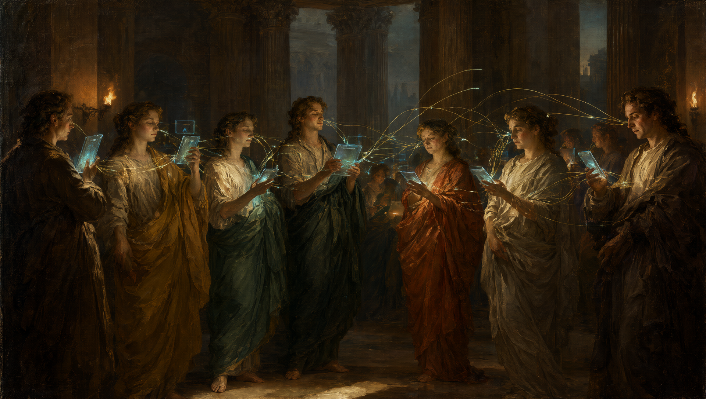<br>
    <b>Qwen Image 2.1 INT8</b><br>
    Score: 9 / 10
  </td>
  <td align="center" width="25%">
    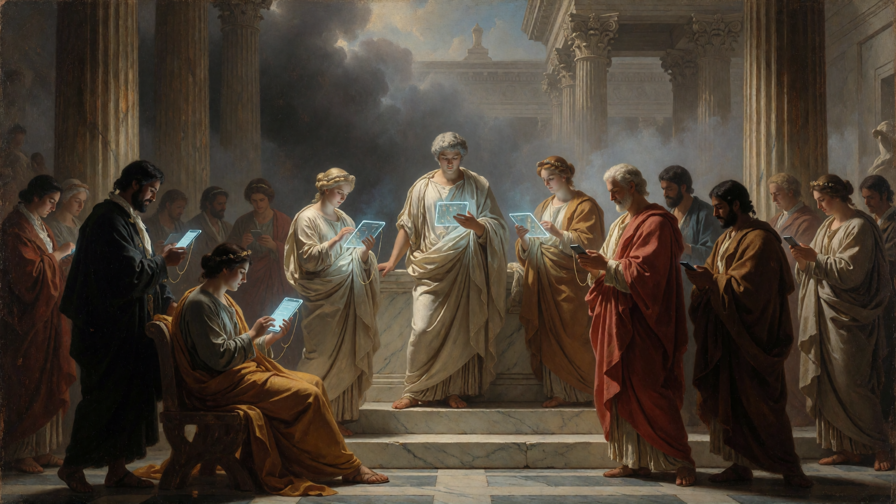<br>
    <b>Krea 2 Turbo INT8 🏆</b><br>
    Score: 9.5 / 10
  </td>
  <td align="center" width="25%">
    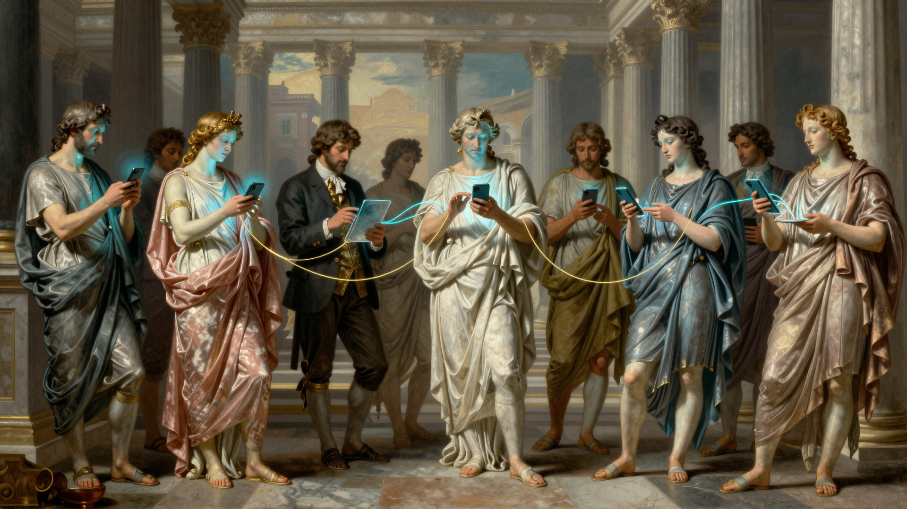<br>
    <b>Z-Image Turbo INT8</b><br>
    Score: 8 / 10
  </td>
  <td align="center" width="25%">
    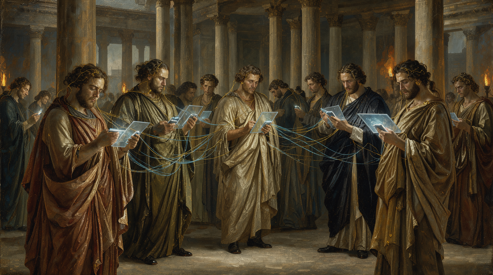<br>
    <b>FLUX 3 Image Klein INT8</b><br>
    Score: 8.5 / 10
  </td>
</tr>
</table>

**Winner:** Krea 2 Turbo — museum-perfect David/Ingres style, dramatic chiaroscuro, golden fiber threads, Corinthian columns, oil painting craquelure. The most historically accurate of the four.

---

### Prompt 2 — Aurora Borealis Poster (1024 × 1536)

*Contemporary eco-modernist graphic poster. Massive Aurora Borealis of emerald green, cyan and solar gold morphing into neural-network circuits. Silhouetted engineers anchoring the light — constructing solar arrays, wind turbines, clean-fusion conduits. Bold vertical composition, minimalist geometric border, archival paper grain.*

<table>
<tr>
  <td align="center" width="25%">
    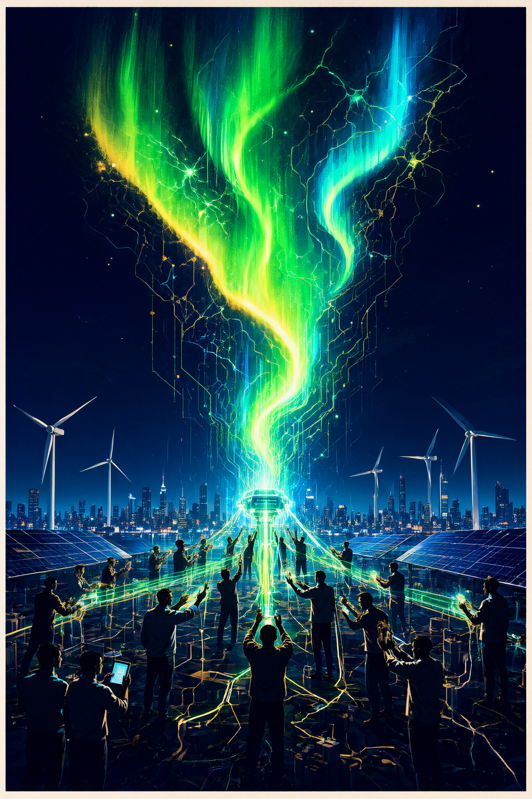<br>
    <b>Qwen Image 2.1 INT8</b><br>
    Score: 9 / 10
  </td>
  <td align="center" width="25%">
    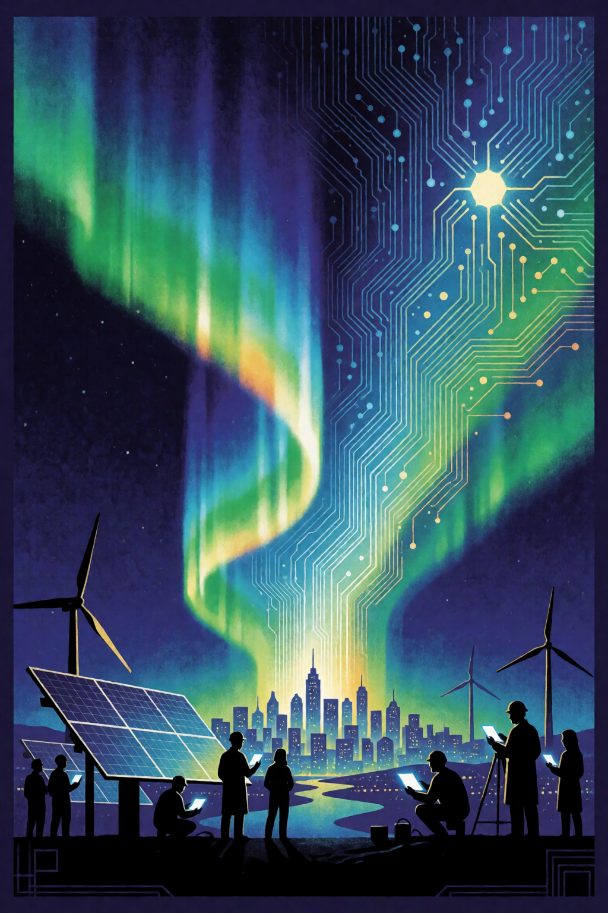<br>
    <b>Krea 2 Turbo INT8 🏆</b><br>
    Score: 10 / 10
  </td>
  <td align="center" width="25%">
    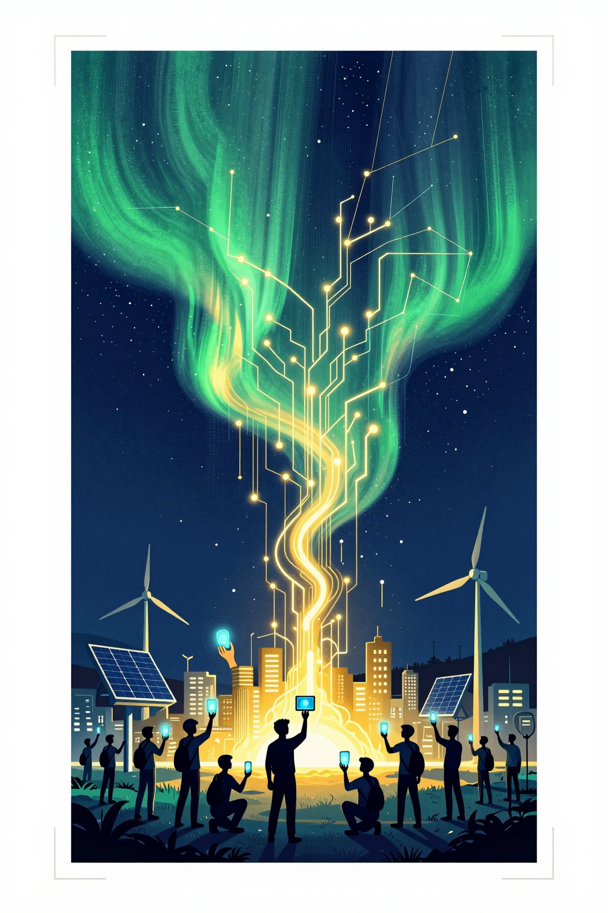<br>
    <b>Z-Image Turbo INT8</b><br>
    Score: 9 / 10
  </td>
  <td align="center" width="25%">
    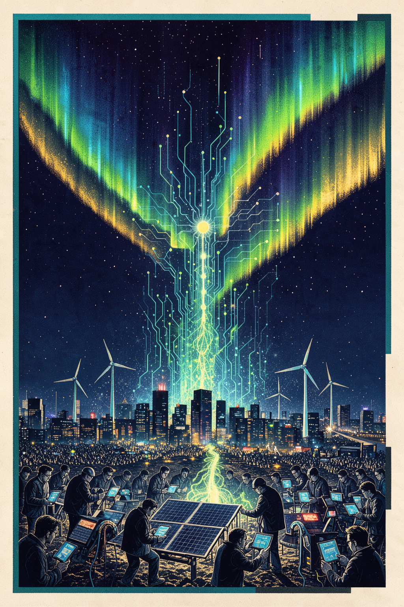<br>
    <b>FLUX 3 Image Klein INT8</b><br>
    Score: 7 / 10
  </td>
</tr>
</table>

**Winner:** Krea 2 Turbo — exact color palette (midnight indigo, emerald, cyan, gold), silhouetted engineers with solar/wind infrastructure, vertical poster composition. No pseudo-text. Perfect editorial illustration.

---

### Prompt 3 — Ethereal Loneliness (1024 × 1280)

*Fine-art editorial photography, dreamlike cinematic realism. Stylish woman in architectural cream silk trench coat, rain-streaked floor-to-ceiling window, minimalist twilight apartment. Warm amber holographic silhouette radiating from a glass device. Kodak Portra 400 grain, shallow depth of field.*

<table>
<tr>
  <td align="center" width="25%">
    <br>
    <b>Qwen Image 2.1 INT8</b><br>
    Score: 8 / 10
  </td>
  <td align="center" width="25%">
    <br>
    <b>Krea 2 Turbo INT8</b><br>
    Score: 8.5 / 10
  </td>
  <td align="center" width="25%">
    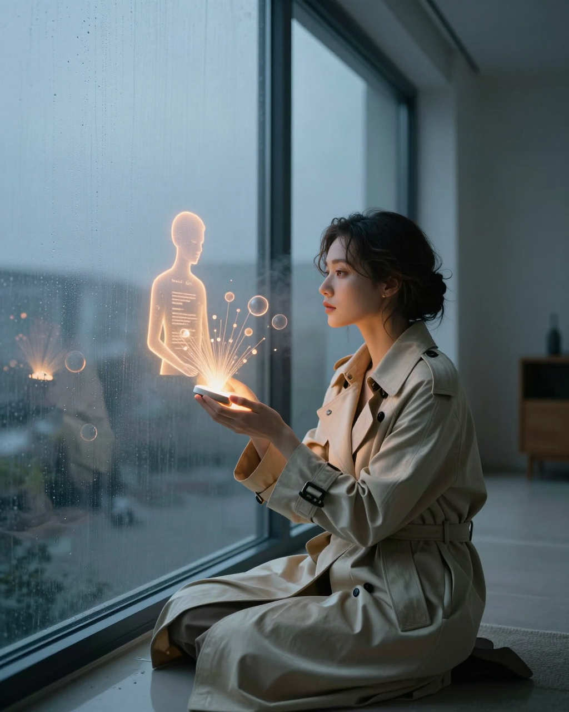<br>
    <b>Z-Image Turbo INT8</b><br>
    Score: 9 / 10
  </td>
  <td align="center" width="25%">
    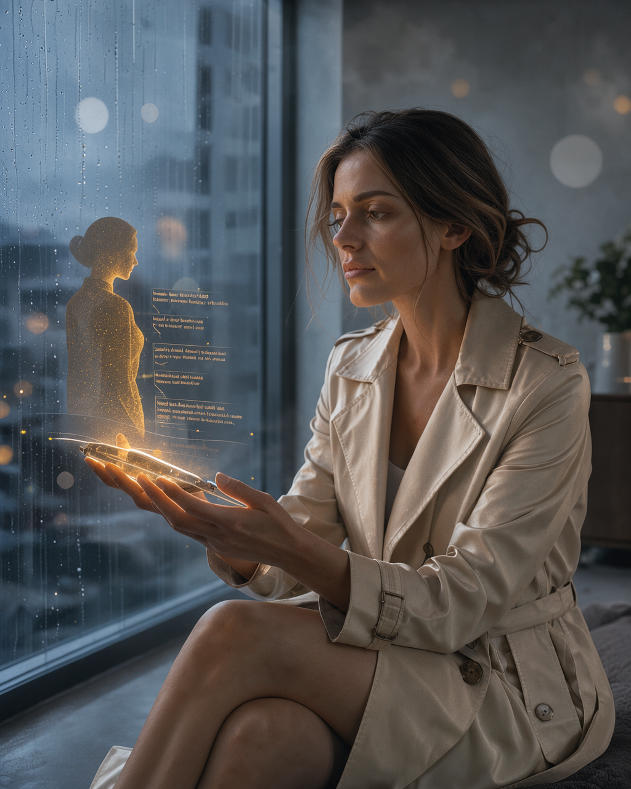<br>
    <b>FLUX 3 Image Klein INT8 🏆</b><br>
    Score: 9.5 / 10
  </td>
</tr>
</table>

**Winner:** FLUX 3 Image Klein — exceptional photorealism, natural skin texture, deep golden/blue contrast, rain on the window, hologram silhouette. The clearest demonstration of FLUX 3's strength in portrait/editorial photography.

---

### Prompt 4 — Bauhaus Poster 1923 (1024 × 1536)

*Herbert Bayer / Joost Schmidt Bauhaus style. Asymmetric geometric grid with mechanical drafting arm and compass on the left cascading primary-color shapes, stylized eye and hand on the right, letterpress texture, archival cream stock. No readable text.*

<table>
<tr>
  <td align="center" width="25%">
    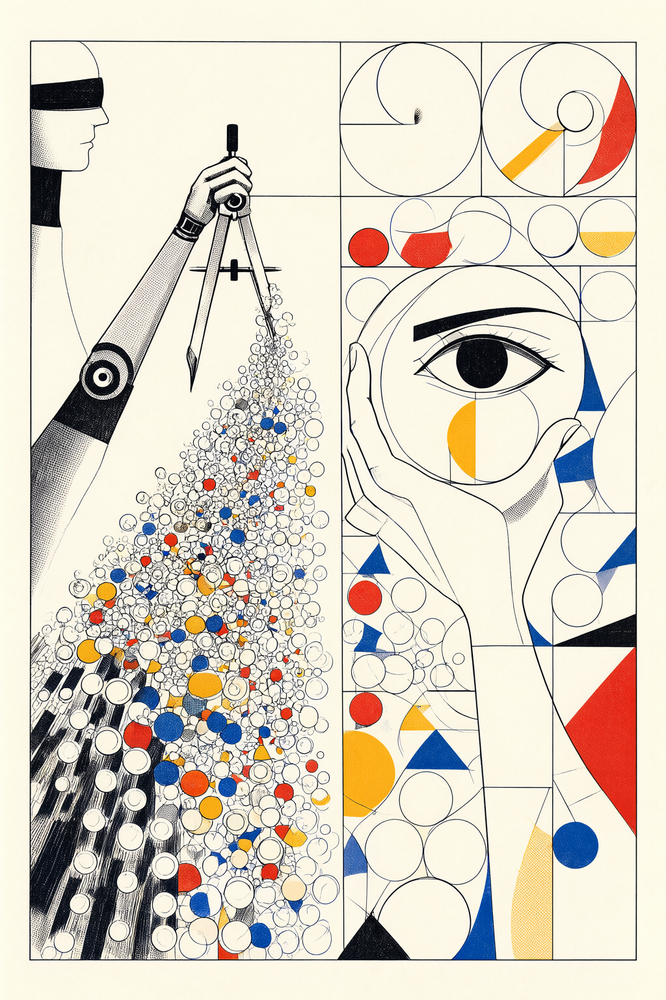<br>
    <b>Qwen Image 2.1 INT8</b><br>
    Score: 9.5 / 10
  </td>
  <td align="center" width="25%">
    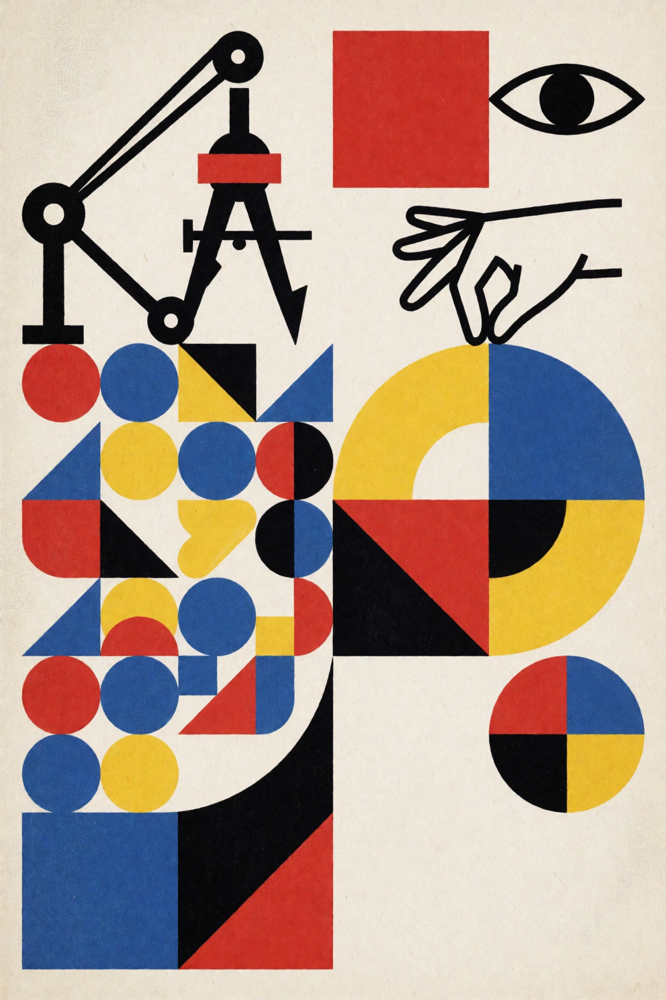<br>
    <b>Krea 2 Turbo INT8 🏆</b><br>
    Score: 10 / 10
  </td>
  <td align="center" width="25%">
    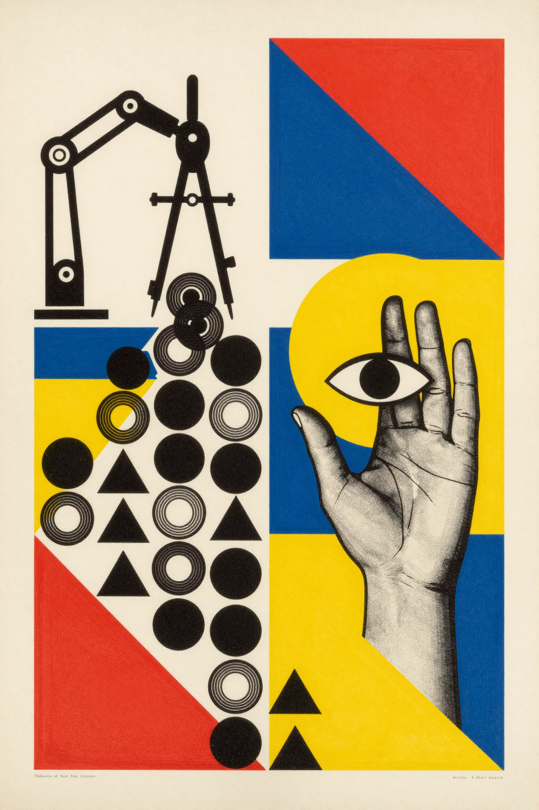<br>
    <b>Z-Image Turbo INT8</b><br>
    Score: 9.5 / 10
  </td>
  <td align="center" width="25%">
    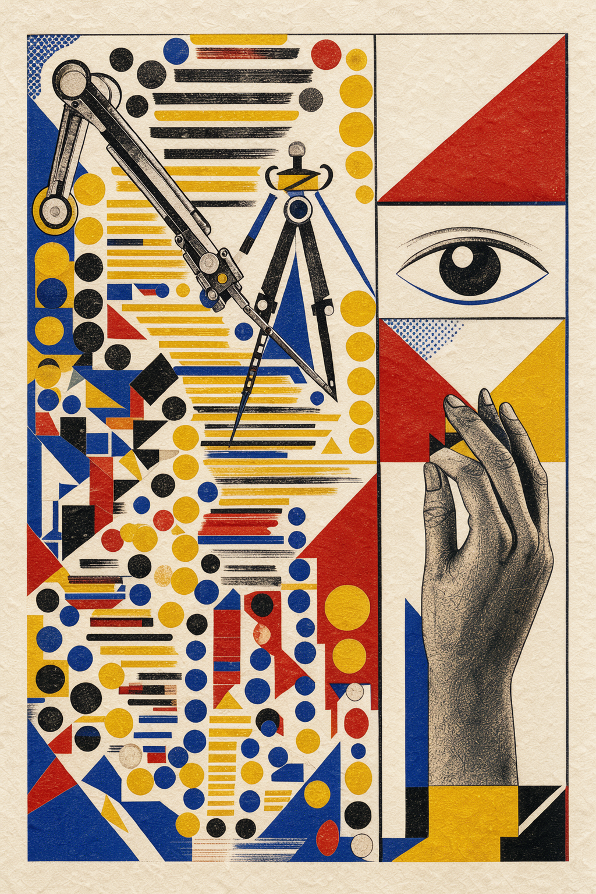<br>
    <b>FLUX 3 Image Klein INT8</b><br>
    Score: 8.5 / 10
  </td>
</tr>
</table>

**Winner:** Krea 2 Turbo — museum-grade 1923 Bauhaus. Mechanical arm + compass, primary colors (red/blue/yellow/black), geometric cascade, stylized eye and hand, letterpress grain, cream background. No readable text. Shared podium with Z-Image (9.5).

---

### Prompt 5 — Vaporwave Web Design (1920 × 1080)

*1990s retro-futurism meets web design history. Marble classical bust with cyan wireframe sunglasses. Staircase of stacked retro OS windows (each representing a web design era). Checkerboard marble floor, chrome spheres, neon palm trees.*

<table>
<tr>
  <td align="center" width="25%">
    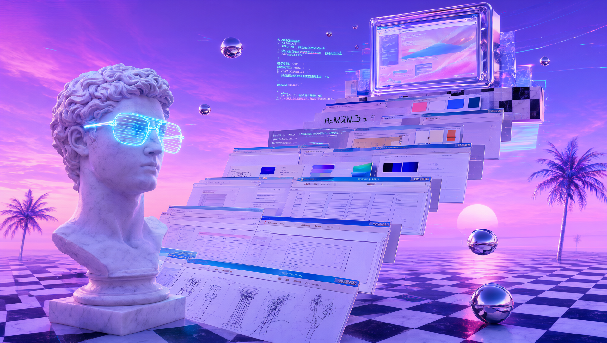<br>
    <b>Qwen Image 2.1 INT8</b><br>
    Score: 9 / 10
  </td>
  <td align="center" width="25%">
    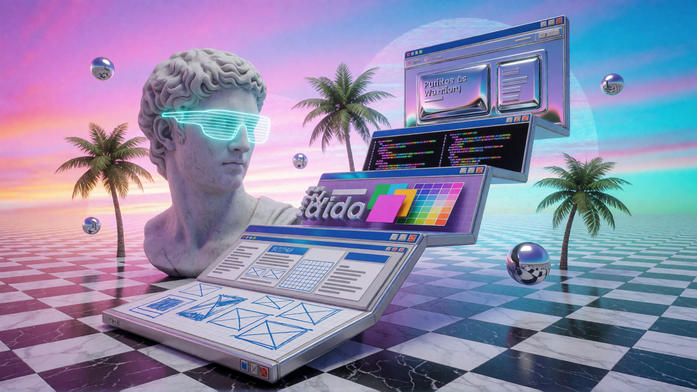<br>
    <b>Krea 2 Turbo INT8</b><br>
    Score: 8.5 / 10
  </td>
  <td align="center" width="25%">
    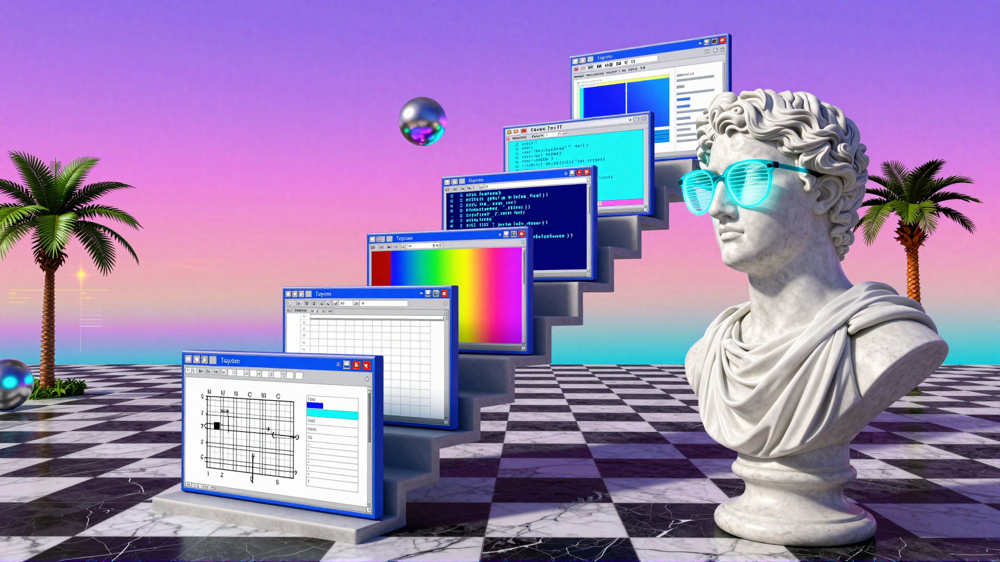<br>
    <b>Z-Image Turbo INT8 🏆</b><br>
    Score: 9.5 / 10
  </td>
  <td align="center" width="25%">
    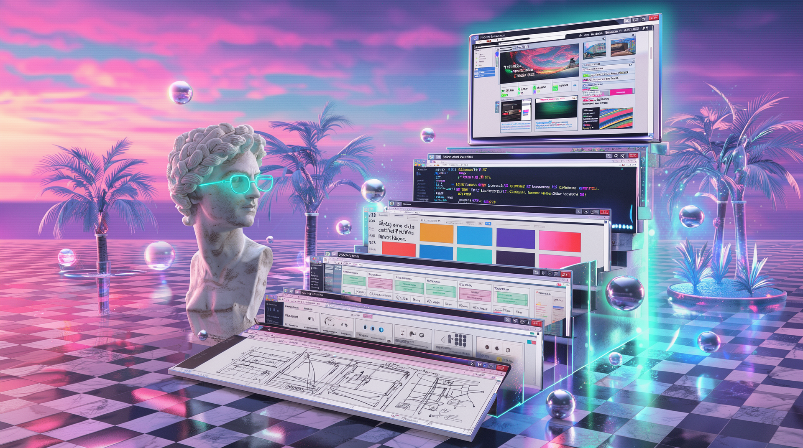<br>
    <b>FLUX 3 Image Klein INT8</b><br>
    Score: 9 / 10
  </td>
</tr>
</table>

**Winner:** Z-Image Turbo — perfect 3D render aesthetic. Marble bust with cyan shutter-glasses, stacked retro OS windows forming a staircase (each showing a web design phase), checkerboard floor, chrome spheres, neon palms. Best "3D studio render" quality of the four.

---

## Model Technical Specifications

### 1. Qwen Image 2.1 INT8 ConvRot

| Property | Value |
|---|---|
| Checkpoint | `qwen_image_2.1_int8_convrot.safetensors` |
| Text encoder | `qwen3vl_8b_w4a8.safetensors` |
| VAE | `qwen_image_2.1_vae_bf16.safetensors` |
| CLIPLoader type | `qwen_image` |
| Latent node | `EmptySD3LatentImage` |
| Steps | 25 |
| CFG | 1.0 |
| Sampler | euler / simple |
| HuggingFace repo | `Comfy-Org/Qwen2.5-VL-7B-Instruct` (gated) |
| License | Qwen License Agreement |

**ComfyUI node graph:**
```
UNETLoader(qwen_image_2.1_int8_convrot.safetensors)  ──┐
CLIPLoader(qwen3vl_8b_w4a8.safetensors, type=qwen_image) ──┤
VAELoader(qwen_image_2.1_vae_bf16.safetensors)        ──┤
CLIPTextEncode(prompt)                                  ──┤─→ KSampler(25 steps, cfg=1.0, euler, simple)
ConditioningZeroOut(negative)                           ──┤       └→ VAEDecode → SaveImage
EmptySD3LatentImage(w, h, batch=1)                     ──┘
```

---

### 2. Krea 2 Raw FP8 Scaled *(deleted — not recommended)*

| Property | Value |
|---|---|
| Checkpoint | `krea2_raw_fp8_scaled.safetensors` (**deleted**) |
| File size | ~12.5 GB |
| CLIPLoader type | `krea2` |
| Scores | 7 / 5 / 9.5 / 6 / 7 = **34.5 / 50** |
| Disposition | Deleted after underperforming vs Turbo on 4 of 5 prompts |

**Reason deleted:** 12.5 GB vs 4.3 GB for Turbo, 34.5/50 vs 46.5/50 total. Turbo is strictly better for all poster/design prompts. Raw only won on Ethereal (9.5 — tied with FLUX 3 Klein). No images available.

---

### 3. Krea 2 Turbo INT8 ConvRot 🏆

| Property | Value |
|---|---|
| Checkpoint | `krea2_turbo_int8_convrot.safetensors` |
| Text encoder | `qwen3vl_4b_int8_convrot.safetensors` (shared with FLUX 3 Klein) |
| VAE | `qwen_image_vae.safetensors` |
| CLIPLoader type | `krea2` |
| Latent node | `EmptyLatentImage` |
| Steps | 8 |
| CFG | 1.0 |
| Sampler | euler / simple |
| HuggingFace repo | `Comfy-Org/Krea-2` (gated) |
| License | Krea Community License (conditional on revenue < $1M) |

**ComfyUI node graph:**
```
UNETLoader(krea2_turbo_int8_convrot.safetensors)        ──┐
CLIPLoader(qwen3vl_4b_int8_convrot.safetensors, type=krea2) ──┤
VAELoader(qwen_image_vae.safetensors)                    ──┤
CLIPTextEncode(prompt)                                    ──┤─→ KSampler(8 steps, cfg=1.0, euler, simple)
ConditioningZeroOut(negative)                             ──┤       └→ VAEDecode → SaveImage
EmptyLatentImage(w, h, batch=1)                          ──┘
```

---

### 4. Z-Image Turbo INT8 ConvRot

| Property | Value |
|---|---|
| Checkpoint | `z_image_turbo_int8_convrot.safetensors` |
| Text encoder | `qwen_3_4b.safetensors` |
| VAE | `ae.safetensors` |
| CLIPLoader type | `lumina2` |
| Required extra node | `ModelSamplingAuraFlow(shift=3.0)` |
| Latent node | `EmptySD3LatentImage` |
| Steps | 8 |
| CFG | 1.0 |
| Sampler | res_multistep / simple |
| License | **Apache 2.0** ✅ (fully commercial) |

**ComfyUI node graph:**
```
UNETLoader(z_image_turbo_int8_convrot.safetensors)    ──┐
CLIPLoader(qwen_3_4b.safetensors, type=lumina2)        ──┤
VAELoader(ae.safetensors)                               ──┤
CLIPTextEncode(prompt)                                  ──┤
ConditioningZeroOut(negative)                           ──┤─→ KSampler(8 steps, cfg=1.0, res_multistep, simple)
EmptySD3LatentImage(w, h, batch=1)                     ──┤       └→ VAEDecode → SaveImage
ModelSamplingAuraFlow(model, shift=3.0)                ──┘   ↑
                                                     (patched model into KSampler)
```

---

### 5. FLUX 3 Image Klein INT8 ConvRot

| Property | Value |
|---|---|
| Checkpoint | `flux3-image-klein-int8-convrot.safetensors` |
| Text encoder | `qwen3vl_4b_int8_convrot.safetensors` (shared with Krea 2 Turbo) |
| VAE | `flux2-vae.safetensors` |
| **CLIPLoader type** | **`flux3`** ⚠️ (never `flux2` — causes OOM crash) |
| Latent node | `EmptyFlux2LatentImage` |
| Steps | 16 |
| CFG | 1.0 |
| Sampler | euler / simple |
| HuggingFace repo | `black-forest-labs/flux-3-image-klein-comfy` (gated) |
| License | FLUX Kommunity License (conditional on revenue < $5M) |
| Minimum dependency | `comfy-kitchen >= 0.2.41` for `flux3` CLIPLoader type |

**ComfyUI node graph:**
```
UNETLoader(flux3-image-klein-int8-convrot.safetensors)    ──┐
CLIPLoader(qwen3vl_4b_int8_convrot.safetensors, type=flux3) ──┤  ← MUST be flux3, not flux2
VAELoader(flux2-vae.safetensors)                           ──┤
CLIPTextEncode(prompt)                                     ──┤─→ KSampler(16 steps, cfg=1.0, euler, simple)
ConditioningZeroOut(negative)                              ──┤       └→ VAEDecode → SaveImage
EmptyFlux2LatentImage(w, h, batch=1)                      ──┘
```

---

## License Overview

| Model | License | Commercial use |
|---|---|---|
| Qwen Image 2.1 | Qwen License | Allowed for most commercial use; verify revenue tier |
| Krea 2 Raw *(deleted)* | Krea Community License | Conditional — revenue < $1M |
| Krea 2 Turbo | Krea Community License | Conditional — revenue < $1M |
| Z-Image Turbo | **Apache 2.0** | ✅ Fully commercial, no revenue cap |
| FLUX 3 Image Klein | FLUX Kommunity License | Conditional — revenue < $5M |

> LAPS AB with ~$100K annual revenue falls well within all conditional tiers.

---

## Troubleshooting

### ⚠️ FLUX 3 OOM crash — wrong CLIPLoader type

**Symptom:** ComfyUI is killed mid-load; kernel OOM message; ~25 GB RAM spike.

**Root cause:** Using `flux2` type with `qwen3vl_4b_int8_convrot.safetensors` triggers the wrong encoder path (Mistral-class FLUX 2 encoder, ~20 GB). The correct type is `flux3`, which loads the klein encoder (~4.6 GB).

**Fix:**
```
CLIPLoader
  clip_name: qwen3vl_4b_int8_convrot.safetensors
  type: flux3   ← not flux2
```

### ⚠️ `flux3` CLIPLoader type missing

**Symptom:** `flux3` does not appear in the CLIPLoader type dropdown.

**Fix:** Update `comfy-kitchen` to 0.2.41 or later:
```bash
uv pip install --python ~/comfy/ComfyUI/.venv/bin/python -r ~/comfy/ComfyUI/requirements.txt
```
Then restart ComfyUI.

### ⚠️ Z-Image Turbo — wrong sampler or missing AuraFlow node

**Fix:** Use `res_multistep` sampler (not `euler`) and include `ModelSamplingAuraFlow(shift=3.0)` wired between UNETLoader and KSampler.

---

## File Index

```
github-report/
├── README.md           ← this file
└── images/
    ├── qwen21-neoclassical.png
    ├── qwen21-aurora-poster.png
    ├── qwen21-ethereal.png
    ├── qwen21-bauhaus.png
    ├── qwen21-vaporwave.png
    ├── krea2turbo-neoclassical.png
    ├── krea2turbo-aurora-poster.png
    ├── krea2turbo-ethereal.png
    ├── krea2turbo-bauhaus.png
    ├── krea2turbo-vaporwave.png
    ├── zimage-neoclassical.png
    ├── zimage-aurora-poster.png
    ├── zimage-ethereal.png
    ├── zimage-bauhaus.png
    ├── zimage-vaporwave.png
    ├── flux3klein-neoclassical.png
    ├── flux3klein-aurora-poster.png
    ├── flux3klein-ethereal.png
    ├── flux3klein-bauhaus.png
    └── flux3klein-vaporwave.png
```

---

*Report generated by LAPS AI content pipeline · 2026-11-19*
